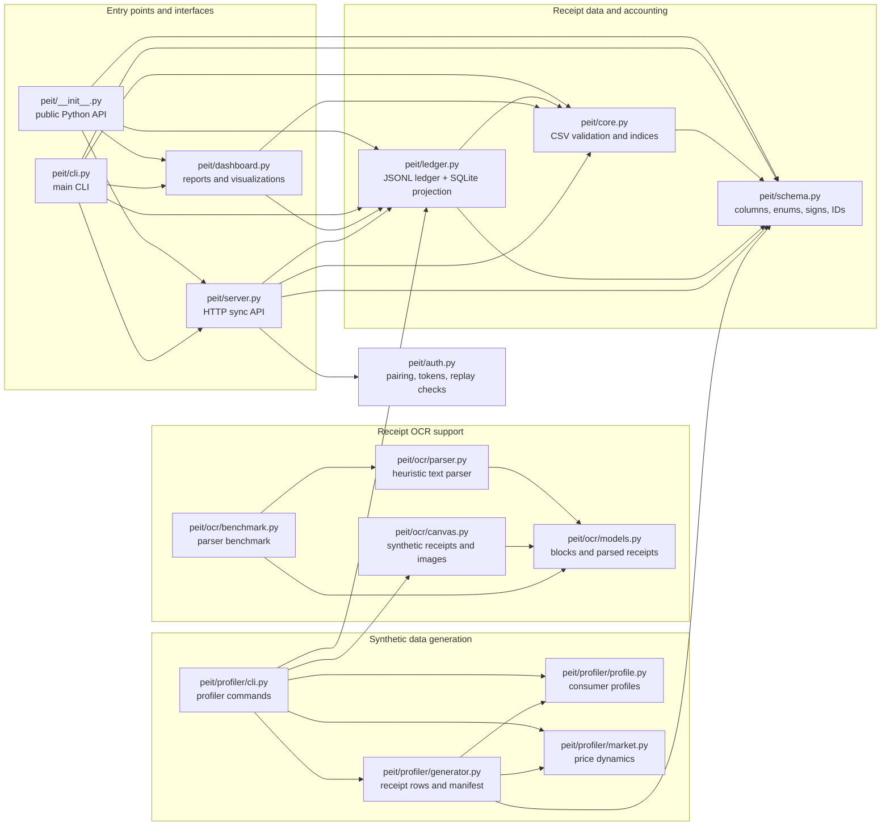
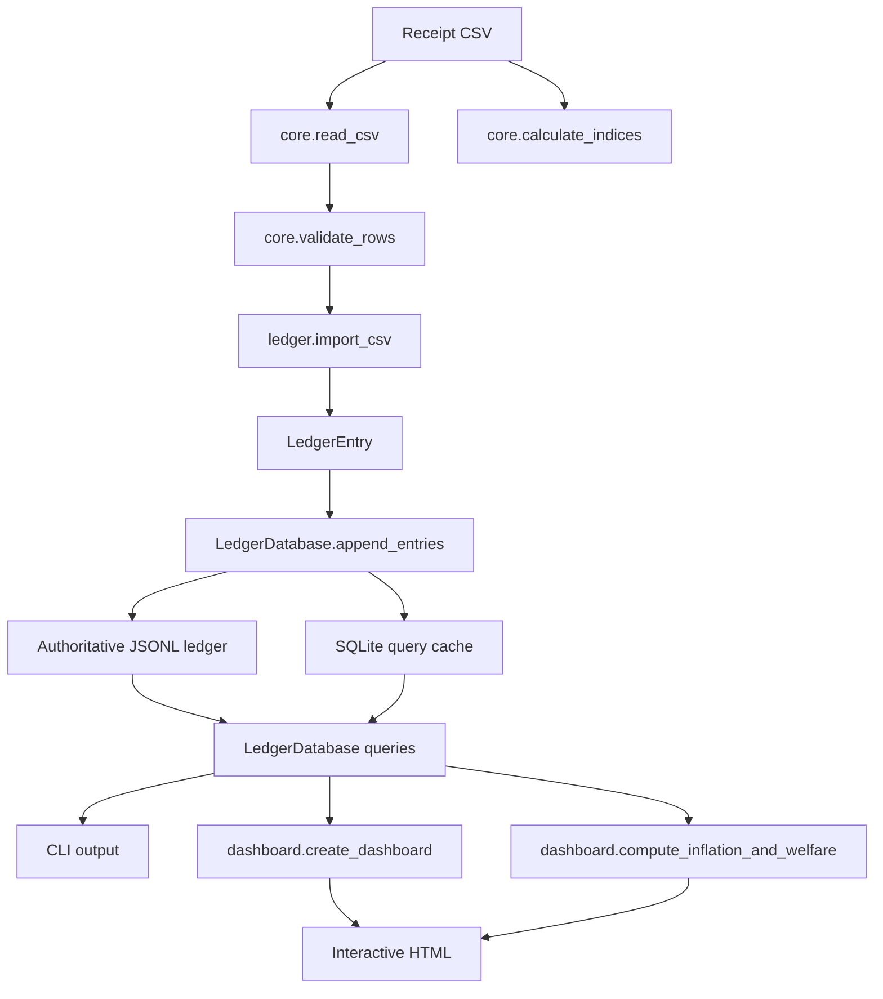
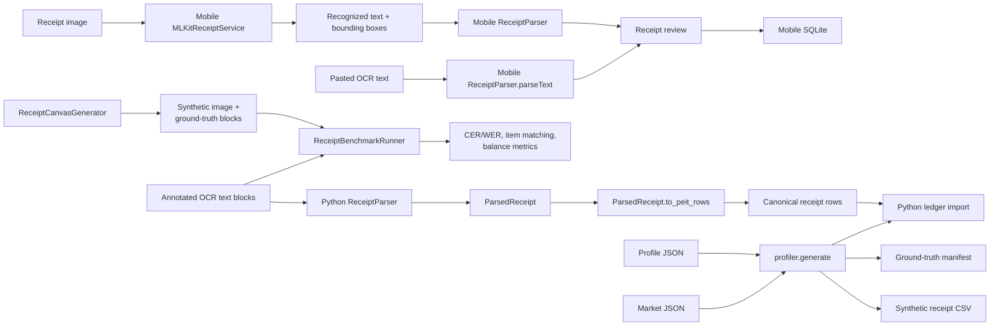
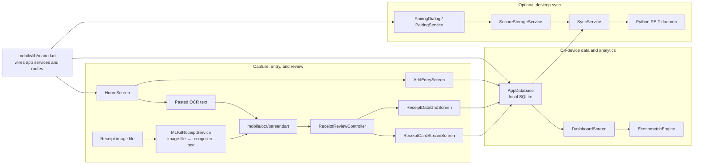
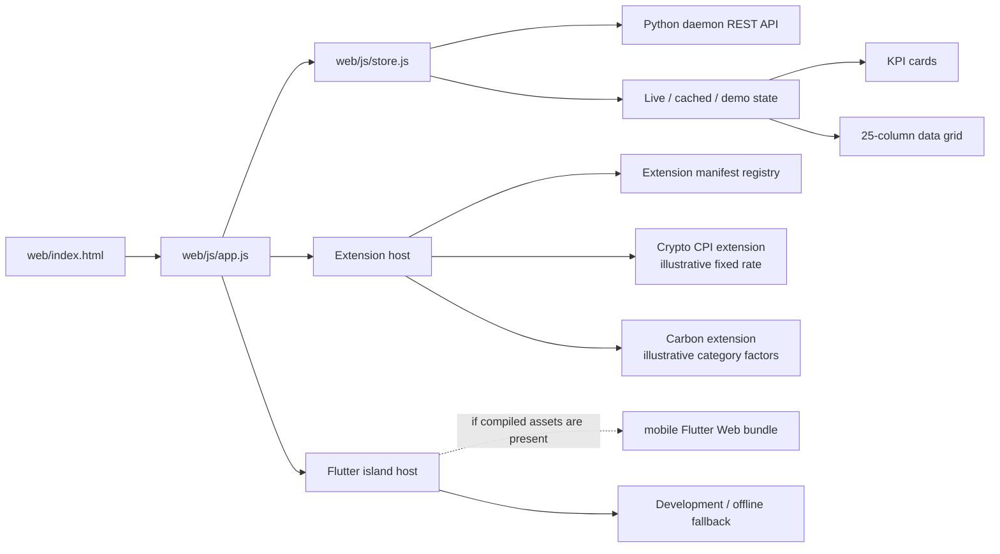
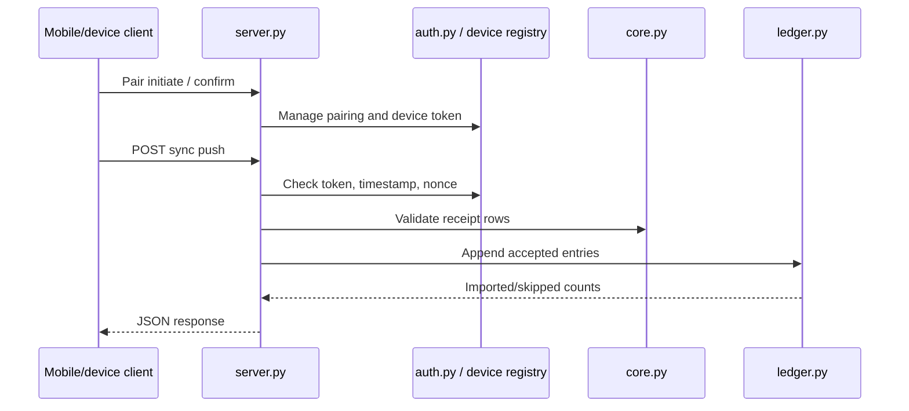

# PEIT Code Map and Demo Guide

A visual guide to the Python implementation in [`src/peit/`](./src/peit/),
the Flutter client in [`mobile/`](./mobile/), and the browser workbench in
[`web/`](./web/). The diagrams describe current code paths; they do not imply
that every planned integration is complete.

## Package at a glance

## Primary receipt and index flow

The index entry points are separate: `core.calculate_indices` computes the
CSV-oriented monthly indicators, while
`dashboard.compute_inflation_and_welfare` computes ledger-based comparisons
and decompositions. Check each function's formula and labels before describing
them as the same index.

## OCR and synthetic data paths

PEIT has image OCR: [`mobile/lib/ocr/mlkit_service.dart`](./mobile/lib/ocr/mlkit_service.dart)
uses on-device ML Kit to recognize text from an image file, then sends the
recognized blocks to the mobile parser. The Home screen's current “Scan / OCR”
action instead accepts pasted OCR text; it does not currently invoke that
image service. The Python benchmark in
[`src/peit/ocr/benchmark.py`](./src/peit/ocr/benchmark.py) parses annotated
text blocks when available and does not itself run OCR on the image. Its
parser metrics should not be described as image-to-text OCR accuracy.

The repository contains real receipt photos under
[`test/data/receipts/`](./test/data/receipts/). Treat them as private evaluation
material; use them in a public demonstration only with permission and
appropriate redaction. Synthetic images from `ReceiptCanvasGenerator` and
synthetic consumer histories from the profiler are separate test/demo inputs.

## Mobile application map

The mobile application is local-first: manual or reviewed entries are saved to
local SQLite, the dashboard computes from local entries, and pending rows can
be pushed to the desktop daemon. The image OCR service exists independently
from the current Home screen's paste-text action.

## Web workbench map

The web store reads the daemon's health, summary, and entries endpoints and
labels its data source. When the daemon is unavailable at a cold start, it
shows clearly marked demonstration fixtures; those fixtures are not the
mobile database. The extensions are useful for demonstrating the plug-in
surface, but their BTC/MXN rate and emissions factors are illustrative rather
than live or validated measurements.

The Flutter island requires a compiled Flutter web bundle. If the bundle is
absent, the host displays its fallback panel; use the native app or emulator
as a separate demo surface unless the embedded build and message bridge have
been verified.

## LAN sync path

TLS is configured by the server when certificate and key paths are supplied.
For sync/security changes, check both [`auth.py`](./src/peit/auth.py) and
[`server.py`](./src/peit/server.py), as well as the mobile client contract.

## Where to look next

| If you are working on… | Start here | Focused tests |
|---|---|---|
| Schema, validation, or index math | [`schema.py`](./src/peit/schema.py), [`core.py`](./src/peit/core.py) | [`test_schema.py`](./test/test_schema.py), [`test_core.py`](./test/test_core.py) |
| Ledger persistence and queries | [`ledger.py`](./src/peit/ledger.py) | [`test_ledger.py`](./test/test_ledger.py) |
| CLI behavior | [`cli.py`](./src/peit/cli.py) | [`test_cli.py`](./test/test_cli.py) |
| Dashboard calculations and HTML | [`dashboard.py`](./src/peit/dashboard.py) | [`test_dashboard.py`](./test/test_dashboard.py) |
| Pairing, sync API, or security | [`auth.py`](./src/peit/auth.py), [`server.py`](./src/peit/server.py) | [`test_security_handshake.py`](./test/test_security_handshake.py), [`test_server.py`](./test/test_server.py), [`test_mobile_sync.py`](./test/test_mobile_sync.py) |
| OCR parsing and receipt models | [`ocr/parser.py`](./src/peit/ocr/parser.py), [`ocr/models.py`](./src/peit/ocr/models.py) | [`test_ocr.py`](./test/test_ocr.py) |
| Synthetic images and benchmark | [`ocr/canvas.py`](./src/peit/ocr/canvas.py), [`ocr/benchmark.py`](./src/peit/ocr/benchmark.py) | [`test_ocr_canvas.py`](./test/test_ocr_canvas.py), [`test_ocr_benchmark.py`](./test/test_ocr_benchmark.py) |
| Synthetic consumer / market data | [`profiler/`](./src/peit/profiler/) | [`test_profiler.py`](./test/test_profiler.py) |
| Web workbench static serving | [`server.py`](./src/peit/server.py), [`web/`](./web/) | [`test_web_server.py`](./test/test_web_server.py) |
| Mobile OCR image recognition | [`mlkit_service.dart`](./mobile/lib/ocr/mlkit_service.dart), [`parser.dart`](./mobile/lib/ocr/parser.dart) | [`ocr_parser_test.dart`](./mobile/test/ocr_parser_test.dart) |
| Mobile review and local persistence | [`receipt_review_controller.dart`](./mobile/lib/controllers/receipt_review_controller.dart), [`database.dart`](./mobile/lib/data/database.dart) | [`review_controller_test.dart`](./mobile/test/review_controller_test.dart), [`model_test.dart`](./mobile/test/model_test.dart) |
| Mobile dashboard calculations | [`econometric_engine.dart`](./mobile/lib/services/econometric_engine.dart), [`dashboard_screen.dart`](./mobile/lib/screens/dashboard_screen.dart) | [`econometric_engine_test.dart`](./mobile/test/econometric_engine_test.dart) |
| Mobile pairing and sync | [`pairing_service.dart`](./mobile/lib/services/pairing_service.dart), [`sync_service.dart`](./mobile/lib/services/sync_service.dart) | [`security_service_test.dart`](./mobile/test/security_service_test.dart), [`mobile_sync` tests](./test/test_mobile_sync.py) |
| Web state, navigation, and extensions | [`app.js`](./web/js/app.js), [`store.js`](./web/js/store.js), [`extension_host.js`](./web/js/extensions/extension_host.js) | [`test_web_server.py`](./test/test_web_server.py) |

For project boundaries and scientific terminology, see [`AGENTS.md`](./AGENTS.md)
and the documentation index in [`doc/README.md`](./doc/README.md).

## Demo showcase design

**Default format:** a 7-minute technical demonstration for a mixed research
and engineering audience. Use a pre-approved, redacted receipt image for the
OCR segment and synthetic, reproducible history for index and ledger
comparisons. Do not display raw personal receipt data or imply the extensions
are validated scientific results.

| Time | Segment | Presenter action and point |
|---|---|---|
| 0:00–0:40 | Motivation | Introduce the difference between a population basket and an individual's observed purchases. State that PEIT records observations locally and derives indicators from them. |
| 0:40–2:15 | Receipt OCR and review | Pass an approved receipt image through the mobile ML Kit service using a verified harness or a wired image-selection action, then review/edit parsed lines and approve or discard them. If using the app as currently wired, disclose that its Home “Scan / OCR” button parses pasted text; do not claim an in-app camera flow. |
| 2:15–3:20 | Local-first workflow | Commit reviewed entries and show they are in the device's local ledger. Open the mobile dashboard to show local cash-flow, category, and price-index views. |
| 3:20–4:15 | Personal price signal | Use a prepared multi-month synthetic history with stable normalized item keys. Explain the index's stated formula, matched-item coverage, and that expenditure change also reflects quantities and basket composition. |
| 4:15–5:15 | LAN synchronization | With a pre-paired device and daemon, push pending records and show the sync result. Identify this as local-network synchronization, not cloud storage. |
| 5:15–6:20 | Desktop workbench | Show the live data-source status, locate the same record in the ledger grid, and demonstrate that the desktop view reflects the synced ledger. |
| 6:20–7:00 | Extensibility and limits | Optionally show an extension view, clearly labeling its hard-coded inputs as illustrative. Close by distinguishing recorded observations, derived indices, and demonstration estimates. |

### Demo preflight

1. Prepare an isolated demo ledger and mobile database with synthetic,
   multi-month history plus one new pending receipt. Reuse exact normalized
   item labels across months so matched-item coverage is interpretable.
2. Select an approved receipt photo, redact identifying details, and verify
   the on-device ML Kit flow on the presentation device. The current Home UI
   exposes text paste, so an image-based live segment needs a verified harness
   or an image-selection UI path.
3. Pair the mobile client and confirm the daemon URL and sync path on the
   actual network before presenting. Keep a separate offline fallback ready.
4. If the daemon is offline, leave the web workbench's Demo Mode/fallback
   indication visible and do not imply its fixture rows came from the phone.
5. Keep the Flutter island optional unless the compiled bundle and
   host/mobile bridge have been verified. Keep crypto and carbon views
   explicitly labeled illustrative.