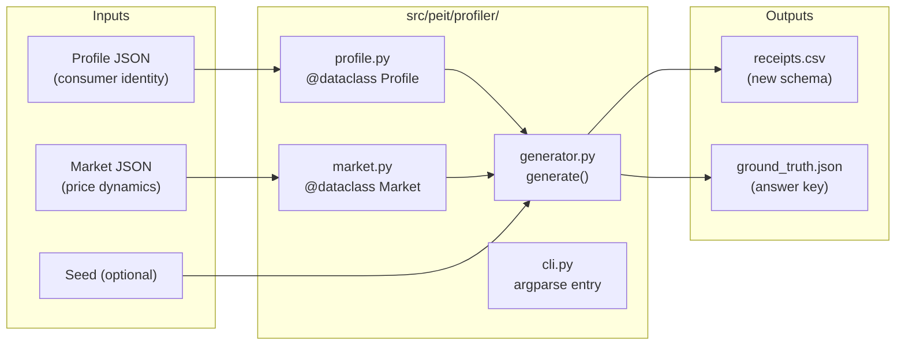

# PLAN_PROFILER: Profile × Market Receipt Generator

## Problem

[generate_dataset.py](util/generate_dataset.py) is a 1,873-line monolith where:

- Consumer behavior and market dynamics are interleaved in procedural code
- Prices are deterministic (`math.sin` noise) — not stochastic
- Each profile (`default`, `alice`) is a separate 700+ line function of hardcoded dict literals
- No JSON externalization — adding a new consumer requires writing Python
- No separation between **what the consumer buys** (signal) and **what prices they face** (market)
- No volume discounting, brand substitution modeling, or store loyalty preferences
- The schema lacks `brand`/`manufacturer` and `pack_size` columns

## Design Thesis

> The profile is the **ground truth signal**. The randomized receipt stream is the **noisy observation**. PEIT's analytics machine must **recover the input profile** from the noise.

This demands a clean separation:

```
Profile (Consumer) × Market (Prices) × Seed (Randomness) → Receipts (CSV) + Ground Truth (JSON)
```

Two identical profiles with different seeds produce different receipt streams, but the analytics should recover the same consumer identity from both.

## Architecture



---

## Proposed Changes

### New CSV Schema

> [!IMPORTANT]
> This is a **new schema** — not backward-compatible with the existing HEADERS. The old `generate_dataset.py` remains untouched.

| # | Column | Type | Description |
|---|--------|------|-------------|
| 1 | `receipt_id` | str | Unique receipt identifier |
| 2 | `receipt_date` | date | `YYYY-MM-DD`, randomized within the month |
| 3 | `merchant` | str | Store name (drawn from profile store preferences) |
| 4 | `description` | str | Raw item text (replaces `item_raw`) |
| 5 | `item` | str | Normalized item key (replaces `item_normalized`) |
| 6 | `brand` | str | **NEW** — Manufacturer/brand (drawn from profile brand preferences) |
| 7 | `category` | str | Expenditure category |
| 8 | `quantity` | int | Number of packs purchased |
| 9 | `pack_size` | int/str | **NEW** — Units per pack (e.g., `1`, `6`, `12`) |
| 10 | `unit` | str | Unit of measure |
| 11 | `unit_price` | decimal | Price per unit within pack (renamed from `shelf_unit_price`) |
| 12 | `currency` | str | ISO currency code |
| 13 | `discount` | decimal | Promotional discount (positive = money saved) |
| 14 | `fee` | decimal | Service fees (negative = charged) |
| 15 | `tax` | decimal | Tax amount (negative = charged) |
| 16 | `deposit` | decimal | Deposits (negative = charged, positive = returned) |
| 17 | `paid_total` | decimal | Net amount (negative = expenditure, positive = income/refund) |
| 18 | `event_type` | str | `recurring`, `one_off`, `income`, `transfer`, `refund` |
| 19 | `notes` | str | Free-text annotation |

Key changes from current schema:
- **Dropped**: `month` (derivable from `receipt_date`), `source_file` (moved to ground truth manifest)
- **Added**: `brand`, `pack_size`
- **Renamed**: `item_raw` → `description`, `item_normalized` → `item`, `shelf_unit_price` → `unit_price`

---

### Profile Dataclass — `src/peit/profiler/profile.py`

#### [NEW] `src/peit/profiler/profile.py`

```python
from dataclasses import dataclass, field
from pathlib import Path
from typing import Literal

@dataclass
class StorePreference:
    merchant: str
    weight: float  # probability weight for selection

@dataclass
class BrandPreference:
    brand: str
    weight: float

@dataclass
class SchedulePolicy:
    """Co-living Deterministic Interval and Renewal / Hazard scheduling."""
    mode: Literal["count", "deterministic", "hazard"]
    # For count mode: fixed purchase count per month (e.g., weekly=4, biweekly=2, daily=30)
    count: int = 1
    # For deterministic mode: periodic cycle (e.g. interval_months=2 for bimonthly)
    interval_months: int = 1
    offset_months: int = 0
    target_months: list[int] | None = None  # Specific calendar months (e.g. [12] for annual)
    # For hazard/renewal mode: depletion / wear-and-tear renewal process
    expected_interval_months: float = 3.0
    hazard_shape: float = 2.5  # Weibull shape (k > 1 increases hazard as gap grows)
    min_gap_months: int = 1     # Refractory period
    max_gap_months: int = 6     # Forced renewal ceiling

@dataclass
class BasketItem:
    item: str               # normalized key ("milk 1 l")
    category: str
    unit: str
    scheduling: SchedulePolicy
    quantity: int            # packs per purchase occasion
    pack_size: int           # units per pack (default 1)
    store_preferences: list[StorePreference]
    brand_preferences: list[BrandPreference]
    # Rich template supporting {product}, {brand}, {variant}, {pack_size}, {unit}
    description_template: str
    description_casing: Literal["natural", "upper", "abbr"] = "natural"

@dataclass
class IncomeSource:
    item: str               # normalized key ("salary payroll biweekly")
    merchant: str
    description: str
    category: str
    amount: float
    frequency: str          # "biweekly", "monthly", "annual"
    schedule: list[int]     # day-of-month list (e.g., [15, 28])
    event_type: str         # "income"

@dataclass
class FinancialBehavior:
    savings_rate: float             # fraction of income saved per month
    discount_seeking_probability: float  # probability of seeking/accepting promotions
    refund_probability: float       # probability of returning an item per month
    savings_merchant: str           # e.g., "Banco Ahorro Inversión"
    savings_description: str

@dataclass
class Scenario:
    """Deterministic pedagogical row injected at a specific month offset."""
    month_offset: int       # 0-indexed month from start
    row: dict               # exact CSV row dict

@dataclass
class Profile:
    name: str
    currency: str
    start_year: int
    months_count: int
    basket: list[BasketItem]
    income: list[IncomeSource]
    financial_behavior: FinancialBehavior
    scenarios: list[Scenario] | None = None

    @classmethod
    def from_json(cls, path: Path) -> "Profile": ...

    def to_json(self, path: Path) -> None: ...
```

---

### Market Dataclass — `src/peit/profiler/market.py`

#### [NEW] `src/peit/profiler/market.py`

```python
@dataclass
class PriceCurve:
    """Discrete pack tier: pack_size → unit_price multiplier."""
    pack_size: int
    unit_price_multiplier: float  # e.g., 0.92 for 8% volume discount

@dataclass
class CatalogItem:
    item: str               # must match BasketItem.item
    base_price: float       # base unit price at pack_size=1
    volatility: float       # σ for Gaussian price noise
    inflation_rate: float   # annual compound rate (e.g., 0.045 for 4.5%)
    # Sticky price & menu cost parameters
    menu_cost_band: float = 0.05    # (s, S) threshold: stay locked if deviation < 5%
    calvo_jump_prob: float = 0.20   # Hazard probability to force price review
    charm_increment: float = 0.50   # Quantize to psychological step (e.g. 0.50)
    pack_tiers: list[PriceCurve] | None = None
    seasonal_modifiers: dict[int, float] | None = None  # month → multiplier

@dataclass
class Market:
    name: str
    currency: str
    catalog: list[CatalogItem]
    global_inflation_rate: float  # fallback if item doesn't specify

    @classmethod
    def from_json(cls, path: Path) -> "Market": ...

    def price_at(self, item: str, month_offset: int, pack_size: int,
                 rng: random.Random, current_shelf_price: float | None = None) -> float:
        """
        Compute sticky regime-jump price for an item at a given month.
        Evaluates latent drift P* = P0 * (1+inf)^(t/12) * exp(ε),
        applies (s, S) menu cost filter against current_shelf_price,
        and quantizes to charm increment.
        """
        ...
```

---

### Generator — `src/peit/profiler/generator.py`

#### [NEW] `src/peit/profiler/generator.py`

Core algorithm:

```python
def generate(
    profile: Profile,
    market: Market,
    seed: int | None = None,
) -> tuple[list[dict[str, str]], dict]:
    """
    Generate receipt rows from Profile × Market with independent item purchases.

    Returns:
        (rows, ground_truth_manifest)
    """
    rng = random.Random(seed)
    rows = []
    
    # Track persistent market shelf prices and hazard elapsed time state
    shelf_prices: dict[str, float] = {}
    last_purchased_month: dict[str, int] = {item.item: -999 for item in profile.basket}

    # 1. Inject deterministic scenarios (if any)
    # 2. For each month:
    #    a. Generate income rows (deterministic schedule from profile)
    #    b. For each basket item:
    #       - Evaluate scheduling:
    #           * count: emit N independent occurrences
    #           * deterministic: test if (month - offset) % interval == 0
    #           * hazard: compute Weibull hazard h(Δt), test rng.random() < h(Δt)
    #       - For each occurrence:
    #           * Draw merchant from store_preferences (weighted random)
    #           * Draw brand from brand_preferences (weighted random)
    #           * Compute price via market.price_at() with (s, S) menu cost filter
    #           * Draw independent receipt_date within month (uniform random)
    #           * Generate unique receipt_id for independent transaction
    #           * Render description from rich template ({product}, {brand}, {variant}, {pack_size}, {unit})
    #           * Apply discount if rng.random() < discount_seeking_probability
    #           * Emit row
    #    c. Generate financial behavior rows (savings transfer, occasional refund)
    # 3. Build ground_truth_manifest (Configuration & Seed Snapshot for reproducibility)

    return rows, manifest
```

---

### CLI — `src/peit/profiler/cli.py`

#### [NEW] `src/peit/profiler/cli.py`

```bash
python -m peit.profiler generate \
  --profile config/profiles/alice.json \
  --market config/markets/mexico_2024.json \
  --seed 42 \
  -o data/Alice/receipts.csv
```

Also supports `--import-ledger` to feed into the migrated `peit.ledger` pipeline.

---

### Package Init — `src/peit/profiler/__init__.py`

#### [NEW] `src/peit/profiler/__init__.py`

Exports: `Profile`, `Market`, `generate`, `HEADERS`.

---

### Example JSON Files

#### [NEW] `config/profiles/`
Minimal example profiles for testing and documentation.

#### [NEW] `config/markets/`
Minimal example market definitions.

---

## Decisions & Design Consensus

> [!IMPORTANT]
> **New schema is not backward-compatible.** The existing `generate_dataset.py` and `peit.ledger.import_csv` pipeline remain untouched. The new profiler produces a different CSV format. A migration adapter for `import_csv` is a future task.

> [!IMPORTANT]
> **Full System-Wide Schema v2 Migration (Two-Phase Execution):**
> - **Phase 1 (Profiler First):** Implement and verify `src/peit/profiler/` with unit tests and Schema v2 output.
> - **Phase 2 (Core & Ledger Migration):** Migrate `config/receipt_schema.csv`, `src/peit/core.py`, and `src/peit/ledger.py` to natively support Schema v2, updating ledger tests and test fixtures.

> [!IMPORTANT]
> **Independent Item Purchases:**
> Basket items draw independent `receipt_date` values and individual `receipt_id`s, generating single-item transaction lines per purchase occasion.

> [!IMPORTANT]
> **TDD approach.** Tests will be written first in `test/test_profiler.py`, defining expected behavior before implementation. This means the first deliverable is a failing test suite.

> [!IMPORTANT]
> **Co-Living Scheduling:**
> `SchedulePolicy` natively supports deterministic intervals (e.g. quarterly, specific calendar months) and renewal/hazard processes (wear-and-tear depletion with Weibull hazard).

> [!IMPORTANT]
> **Sticky Price Regime Jumps from Gaussian Noise:**
> Market dynamics use latent Gaussian shocks combined with an $(s, S)$ menu-cost threshold filter, Calvo hazard jumps, and charm rounding to produce realistic sticky prices.

> [!IMPORTANT]
> **Ground Truth Manifest:**
> `ground_truth.json` exports a complete configuration and seed snapshot ensuring 100% deterministic simulation reproducibility.

---

## Execution Roadmap (TDD)

### Phase 1: Profiler Implementation & TDD
1. **Tests first:** Write `test/test_profiler.py` with tests for:
   - Profile dataclass construction and JSON round-trip
   - Co-living scheduling (count, deterministic interval, hazard/renewal)
   - Market dataclass construction and sticky `price_at()` behavior
   - Discrete pack tiers and volume discounting
   - Generator output Schema v2 validation
   - Generator determinism with seed
   - Generator stochasticity without seed
   - Weighted store and brand preference selection
   - Rich template description rendering
   - Scenario injection
   - Ground truth configuration & seed manifest emission
2. **Implement dataclasses:** `profile.py`, `market.py`
3. **Implement generator:** `generator.py`
4. **Implement CLI:** `cli.py`, `__init__.py`, `__main__.py`
5. **Write example JSON profiles and markets**
6. **Verify all profiler tests pass**

### Phase 2: Core & Ledger Schema v2 Migration
1. Update `config/receipt_schema.csv` to 19-column Schema v2.
2. Update `src/peit/core.py` validation and schema constants.
3. Update `src/peit/ledger.py` (`LedgerEntry`, `compute_entry_id`, SQLite table schema, and CSV ingestion).
4. Update tests (`test/test_core.py`, `test/test_ledger.py`, `test/test_cli.py`, `test/test_dashboard.py`).
5. Verify entire test suite passes (`pytest test/ -v`).

---

## Verification Plan

### Automated Tests
```bash
# Profiler test suite:
python -m pytest test/test_profiler.py -v

# Full project test suite after Phase 2:
python -m pytest test/ -v
```

### Statistical Verification
- Generate two datasets from the same profile with different seeds:
  - Verify distinct `receipt_date` and `receipt_id` sequences.
  - Verify convergence to expected basket composition and brand shares.
- Verify sticky price dynamics: shelf prices remain constant across small noise fluctuations and jump in discrete steps when the menu cost threshold is crossed.

### Manual Verification
- Inspect generated CSV for exact 19-column Schema v2 alignment.
- Verify `ground_truth.json` enables exact re-generation of identical data.
