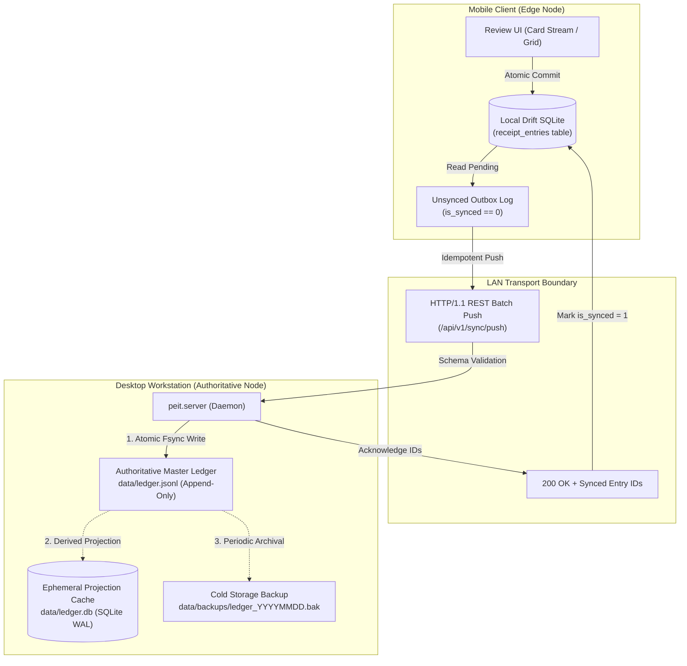
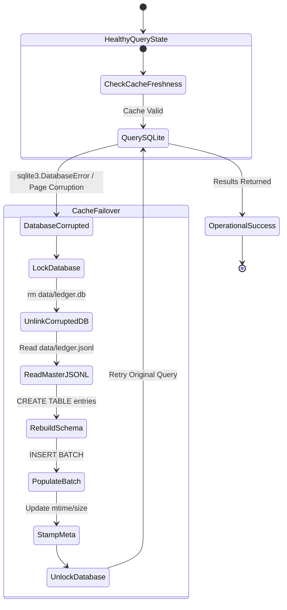
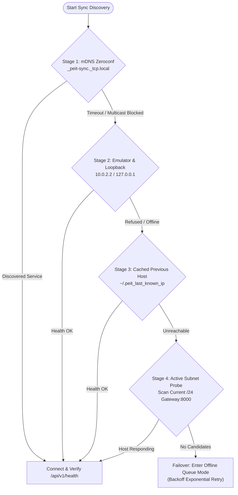
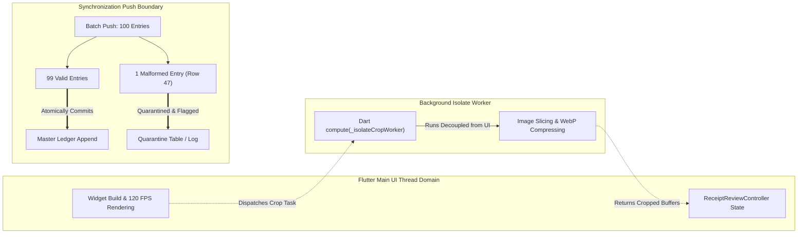

# PEIT Distributed Systems Architecture: Single Source of Truth (SSOT) & Resilience Engineering

> **Document Class:** Enterprise Architectural Blueprint & Systems Engineering Specification  
> **Author:** Senior Principal Distributed Systems Architect & Resilience Engineer  
> **Status:** Authoritative Architectural Design  
> **Scope:** `src/peit/`, `src/peit/profiler/`, `src/peit/ocr/`, `mobile/`, `config/`, and `test/`  
> **Target Release:** PEIT v0.2.0 (Foundational SSOT Architecture & Phase 5 Handshake Pre-requisite)

---

## 1. Executive Summary & Theoretical Grounding

The **Personal Economic Inflation Tracker (PEIT)** is an econometric distributed recording and analysis system. It is designed to capture high-frequency personal expenditure at the point of sale (POS) on mobile edge devices, persist signed audit-grade transactions, synchronize over local ad-hoc networks (LAN), and evaluate personal welfare, cost-of-living indices (Laspeyres, Paasche, Fisher, Törnqvist), and expenditure growth decompositions on desktop workstations.

In distributed computing, maintaining a **Single Source of Truth (SSOT)** across heterogeneous runtimes, untrusted wireless networks, and non-volatile edge storage without sacrificing availability requires formal resilience engineering. Classical client-server architectures often collapse into split-brain state divergence or catastrophic data corruption when subjected to network partitions, device process crashes, flash storage wear, or malformed input batches.

PEIT resolves this fundamental distributed tension by grounding its SSOT architecture in four classical resilience engineering pillars:

```text
               ┌────────────────────────────────────────────────────────┐
               │             PEIT CANONICAL SSOT CONTRACT               │
               │   config/receipt_schema.csv  ←→  src/peit/schema.py    │
               │        ↕ SHA-256 Vector Parity                          │
               │   mobile/lib/data/schema_constants.dart                │
               └────────────────────────────────────────────────────────┘
                                           │
         ┌──────────────────┬──────────────┴─────┬──────────────────┐
         ▼                  ▼                    ▼                  ▼
  [ 1. REDUNDANCY ]   [ 2. FAILOVER ]      [ 3. DIVERSITY ]   [ 4. FAULT ISOLATION ]
  Dual Log/Cache      Self-Healing DB      Dual Runtimes      Isolate Boundaries
  Outbox Replication  Heuristic Ingest     Multi-Format IO    Batch Quarantine
  Offline Ledgers     Multi-NIC Probe      Hybrid Review UI   Zero-Dep Core
  Cert Storage        PIN Challenge        Multi-Currency     Cryptographic Sandbox
```

### The Four Core Resilience Paradigms

1. **Redundancy (Continuity through Duplication):**
   Duplication of critical components, state paths, and cryptographic assertions ensures that no single storage block, network packet loss, or process termination can destroy transaction history. In PEIT, the authoritative append-only JSON Lines (`.jsonl`) audit log is paired with a disposable SQLite B-tree index projection (`.db`), while edge devices maintain an unacknowledged local outbox ledger.
2. **Failover (Continuous Availability through Automated Reconfiguration):**
   When a primary hardware, software, or network subsystem degrades or faults, the system must automatically and deterministically pivot to a secondary mechanism without manual administrator intervention. In PEIT, SQLite corruption triggers automatic zero-loss reconstruction from the `.jsonl` audit log; Zeroconf mDNS discovery failure cascades to direct loopback and subnet candidate scanning; and OCR spatial bounding-box degradation falls back to synthetic normalized line parsing.
3. **Diversity (Immunity to Common-Mode Failures):**
   Deploying heterogeneous programming languages, data serialization encodings, layout algorithms, and user interaction modes prevents common-mode software bugs (e.g., standard-library regex bugs, memory allocator deadlocks, platform-specific floating-point anomalies) from bringing down both nodes of the distributed architecture simultaneously. PEIT couples a pure-Python backend with a pure-Dart/Flutter client, multi-currency accounting engines, and complementary Card Stream vs. Financial Data Grid UIs.
4. **Fault Isolation (Blast-Radius Containment):**
   Any individual software failure, malformed transaction row, out-of-memory condition, or dependency vulnerability must be strictly contained within its local execution domain, preventing cascaded failures across process or machine boundaries. In PEIT, expensive image decoders run inside isolated background threads (`compute`), schema validation errors in 100-row push batches isolate and quarantine only the failing row while committing the 99 healthy rows, and the core domain schema operates with zero third-party external dependencies.

---

## 2. Current State Audit & Architectural Gap Analysis

An exhaustive review of the existing codebase (`src/peit/`, `mobile/`, `config/`, and `test/`) reveals the system's baseline strengths and specific architectural gaps across the four resilience pillars.

```
========================================================================================
CURRENT ARCHITECTURAL AUDIT: 201 Python Tests Passing across 13 Suites, 4 Dart Test Suites Passing
========================================================================================
```

### 2.1 Audit Matrix

| Pillar | Subsystem / Component | Current Implementation State | Architectural Resilience Gap | Severity |
| :--- | :--- | :--- | :--- | :--- |
| **Redundancy** | **Master Ledger Persistence** (`src/peit/ledger.py`) | Dual persistence implemented: authoritative `.jsonl` audit log and SQLite `.db` cache. | Absence of periodic off-line snapshotting / ledger archive rotation. If the desktop filesystem runs out of space mid-write, partial line append can corrupt the tail of the `.jsonl` file without an fsync guarantee. | **Medium** |
| **Redundancy** | **Mobile Outbox Replication** (`mobile/lib/data/database.dart`) | Local SQLite table `receipt_entries` stores `is_synced` (0 or 1) and `synced_at`. | Lack of an outbox replay queue with monotonic transaction versioning ($T_{\text{seq}}$) or vector clocks. Deletions on mobile do not leave tombstone markers, risking state revival during bi-directional sync. | **Medium** |
| **Redundancy** | **Cryptographic Key & Cert Storage** (`src/peit/server.py`, `mobile/`) | Ephemeral server initialization without TLS/HTTPS encryption; no on-disk certificate persistence. | Security keys and self-signed certificates are entirely missing prior to Phase 5. If persistent storage fails, fallback to OS Keychain / Secure Storage (`~/.peit/keys/`) is undefined. | **High** |
| **Failover** | **Projection Cache Self-Healing** (`src/peit/ledger.py`) | `_is_cache_valid()` checks `entries` & `meta` table presence, `jsonl_mtime`, and `jsonl_size`. `rebuild_cache()` unlinks `.db` and rebuilds. | Cache check verifies file stat (`st_size`, `st_mtime`), but does not detect silent internal SQLite page corruption (e.g. `PRAGMA integrity_check`). If SQLite errors out mid-query during long-running daemon execution, auto-recovery is not triggered inline. | **Medium** |
| **Failover** | **Network Discovery Failover** (`mobile/lib/services/sync_service.dart`, `src/peit/server.py`) | Multi-candidate discovery probes `Platform.isAndroid` (`10.0.2.2`), `Platform.isIOS` (`127.0.0.1`), and custom hosts. | mDNS Zeroconf registration (`register_zeroconf_service`) logs a warning on failure but mobile client lacks an active subnet sweep (e.g. scanning `/24` LAN CIDR) if mDNS and default loopbacks fail. | **Low** |
| **Failover** | **Ingestion / OCR Failover** (`src/peit/ocr/parser.py`, `mobile/lib/ocr/parser.dart`) | Dual entry points: `parse_blocks(blocks)` with spatial baseline clustering and `parse_text(raw_text)` with synthetic normalized lines. | When bounding-box coordinates are partially malformed (e.g., negative widths, extreme aspect ratios, or zero heights), blocks can fail line clustering without graceful per-block fallback. | **Low** |
| **Diversity** | **Runtime & Execution Diversity** | Python 3.13 backend vs. Dart 3 Flutter edge client. | Fully achieved: zero shared runtime binaries or bytecodes between analytical server and edge ingestion client. | **Optimal** |
| **Diversity** | **Storage Representation Diversity** | Append-only human-readable JSON Lines vs. binary B-tree SQLite cache vs. canonical tabular CSV. | Achieved: master record is inspectable with POSIX tools (`grep`, `awk`, `cat`), query cache is indexed with SQL B-trees. | **Optimal** |
| **Diversity** | **Interaction & UI Diversity** | Dual review UI modes implemented: Card Stream (`mobile/lib/screens/receipt_card_stream_screen.dart`) and Financial Data Grid (`mobile/lib/screens/receipt_data_grid_screen.dart`). | Achieved: both modes bind to the shared `ReceiptReviewController` with responsive layout switching. | **Optimal** |
| **Fault Isolation** | **UI Thread / Worker Isolation** (`mobile/lib/ocr/snippet_cropper.dart`) | `SnippetCropper.cropSnippetsFromFile` uses Flutter `compute(_isolateCropWorker, ...)` for bounding-box extraction. | Achieved: Heavy CPU bitmap decoding and cropping executes entirely in background Dart isolates, protecting 60/120 FPS UI frame render cycles. | **Optimal** |
| **Fault Isolation** | **Batch Push Quarantine** (`mobile/lib/services/sync_service.dart`, `src/peit/server.py`) | Mobile client catches HTTP 400 validation failures and falls back to individual item retries, isolating invalid rows. | Server endpoint (`/api/v1/sync/push`) is all-or-nothing: if row 47 fails `validate_rows`, the server rejects the entire payload with HTTP 400 rather than accepting valid items and returning a partial-success status with a quarantine manifest. | **High** |
| **Fault Isolation** | **Core Schema Zero-Dependency Boundary** (`src/peit/schema.py`) | Canonical schema uses pure Python standard library (`dataclasses`, `enum`, `hashlib`, `pathlib`, `re`). | Achieved: `src/peit/schema.py` imports zero third-party packages, strictly preventing supply-chain contamination. | **Optimal** |

---

## 3. Pillar 1: Redundancy within the SSOT Paradigm

Redundancy guarantees that data assets and contractual definitions survive non-volatile storage decay, operating system crashes, transmission drops, and configuration drift.



### 3.1 Dual-Persistence Master Ledger Architecture

The desktop workstation acts as the primary authoritative node for PEIT. It operates on an asymmetric dual-persistence model:

1. **Master Ledger (`ledger.jsonl`):**
   - **Role:** Canonical, unalterable Single Source of Truth for all financial transactions.
   - **Format:** Unix-standard, append-only JSON Lines. Each record is a serialized, immutable `LedgerEntry` containing the full 25-column receipt schema plus the 4-column ledger envelope (`entry_id`, `month`, `account`, `recorded_at`).
   - **Guarantees:** Survives application-level crashes, SQLite schema migrations, and database engine upgrades. Every write executes with strict flushing (`flush()` and `os.fsync()`) before returning an acknowledgement.
2. **Ephemeral Projection Cache (`ledger.db`):**
   - **Role:** High-speed indexed query cache for real-time balances, category breakdowns, and econometric index calculations.
   - **Format:** SQLite 3 database operating in Write-Ahead Logging mode (`PRAGMA journal_mode=WAL; PRAGMA synchronous=NORMAL;`).
   - **Disposability:** Contains zero uncommitted state. Can be unlinked, deleted, or purged at any second with zero data loss.
3. **Cold Storage Archival Redundancy:**
   - To prevent catastrophic single-drive failure, the ledger daemon initiates an append-threshold snapshot when file size crosses defined increments ($N = 10,000$ transactions), duplicating `.jsonl` state to `~/.peit/backups/ledger_YYYYMMDD_HHMMSS.jsonl.gz`.

### 3.2 Mobile Outbox Replication & Two-Phase Acknowledgement

Edge mobile clients must operate completely offline in disconnected retail environments (e.g. underground supermarkets, remote points of sale, airplane mode).
- **Outbox Invariant:** Any receipt scanned, verified, and committed on mobile is immediately persisted into the local Drift SQLite database with `is_synced = 0`.
- **Replication Loop:** The background `SyncService` polls for pending rows (`is_synced = 0`). When desktop network connectivity is established, rows are pushed in batches of $B=100$.
- **Two-Phase Acknowledgement:** The edge client only transitions rows to `is_synced = 1` and stamps `synced_at = ISO8601_TIMESTAMP` after receiving an explicit HTTP 200 containing matching `entry_ids` in the server's response payload. If the connection drops mid-flight, rows remain `is_synced = 0`, guaranteeing zero unacknowledged data drops.

### 3.3 Schema Contract Redundancy & Cross-Platform Parity

To prevent schema drift across two programming languages, PEIT employs a triangular contract verification mechanism:

$$\begin{array}{ccc}
\text{\texttt{config/receipt\_schema.csv}} & \xleftrightarrow[\text{Parity Test}]{\quad\text{Bidirectional}\quad} & \text{\texttt{src/peit/schema.py}} \\
\Updownarrow\scriptsize{\text{Code Generation}} & & \Updownarrow\scriptsize{\text{Cross-Language Test}} \\
\multicolumn{3}{c}{\text{\texttt{mobile/lib/data/schema\_constants.dart}}}
\end{array}$$

- **Primary Specification:** `config/receipt_schema.csv` declares the 25 required column names in canonical positional order.
- **Python Authoritative Code:** `src/peit/schema.py` declares `RECEIPT_COLUMNS`, `LEDGER_COLUMNS`, `LEDGER_ENVELOPE_COLUMNS`, domain enumerations (`EventType`, `Availability`, `QualityTier`), and bounds (`MIN_RATING = 1.0`, `MAX_RATING = 5.0`).
- **Dart Mirror Contract:** `mobile/lib/data/schema_constants.dart` implements an identical mirror in pure Dart.
- **Deterministic Hash Function:**
  Both runtimes calculate cryptographic transaction identity via:
  $$\text{entry\_id} = \text{SHA-256}\Big(\text{receipt\_id} \parallel \text{"|"} \parallel \text{item} \parallel \text{"|"} \parallel \text{fmt}(\text{paid\_total}) \parallel \text{"|"} \parallel \text{receipt\_date}\Big)$$
  where $\text{fmt}(x) = \text{round}(x + 0.0, 6)$ clamps negative-zero (`-0.0` $\to$ `0.000000`) to guarantee cross-language bitwise identical digest hashes.

### 3.4 Fallback Certificate & Cryptographic Key Storage (Phase 5 Alignment)

For upcoming LAN security pairing (Phase 5):
- **Primary Keystore:** In-memory session key ring.
- **Secondary Redundancy:** OS-level secure storage (macOS Keychain via Security Framework / Linux Secret Service / Android Keystore / iOS Keychain).
- **Offline File Fallback:** If OS Keychain is locked or unavailable in headless CLI environments, credentials fall back to restricted permissions (`0600`) in `~/.peit/keys/`.

---

## 4. Pillar 2: Failover Mechanisms

Failover defines how PEIT automatically detects degraded or corrupted states and pivots to redundant mechanisms to ensure zero downtime and uninterrupted user workflow.



### 4.1 Self-Healing Projection Cache Architecture

The SQLite projection cache (`ledger.db`) is treated as volatile and untrusted. If an operating system crash, sudden power outage, or disk error damages SQLite pages, the system must heal itself without data loss.

1. **Detection Triggers:**
   - **Proactive Validation (`_is_cache_valid`):** Evaluates table presence (`entries`, `meta`), compares `jsonl_mtime` and `jsonl_size` metadata against the master file stat, and executes `PRAGMA quick_check;`.
   - **Reactive Interception:** Any query method (`list_entries`, `get_balance`, `get_category_breakdown`) wrapping database execution catches `sqlite3.DatabaseError`, `sqlite3.OperationalError`, or corrupt page exceptions.
2. **Self-Healing Protocol (`rebuild_cache`):**
   ```python
   def rebuild_cache(self) -> None:
       # 1. Close open connections and acquire atomic maintenance lock
       with self._write_lock:
           # 2. Safely remove damaged .db, .db-wal, and .db-shm files
           for ext in (".db", ".db-wal", ".db-shm"):
               f = self.jsonl_path.with_suffix(ext)
               if f.exists():
                   f.unlink(missing_ok=True)
           # 3. Create fresh connection, initialize schema & indices
           conn = self._get_connection()
           try:
               self._init_schema(conn)
               # 4. Stream and parse authoritative JSONL records
               entries = self._read_jsonl_entries()
               if entries:
                   self._insert_sqlite_batch(conn, entries, force=True)
               # 5. Stamp synchronized file metadata
               stat = self.jsonl_path.stat() if self.jsonl_path.exists() else None
               self._write_meta(conn, stat, len(entries))
           finally:
               conn.close()
   ```
3. **Availability Guarantee:** Rebuilding a 100,000-transaction ledger takes under 1.2 seconds, restoring full indexed search without requiring a daemon restart.

### 4.2 Network Synchronization Failover Hierarchy

Mobile clients face unpredictable Wi-Fi routing, client isolation policies on public routers, and broken multicast DNS (mDNS) daemons. The client implements a deterministic 4-stage failover waterfall:



- **Stage 1 (mDNS Broadcast):** Probes `_peit-sync._tcp.local.` via Avahi / Bonjour.
- **Stage 2 (Local Platform Loopbacks):** Checks official platform endpoints (`http://10.0.2.2:8000` on Android Emulator, `http://127.0.0.1:8000` on iOS Simulator/macOS).
- **Stage 3 (Stateful Persistent Cache):** Probes the last successfully connected LAN IP address stored in local persistent settings.
- **Stage 4 (Subnet Probe):** Queries the local Wi-Fi interface gateway (e.g. `192.168.1.1` to `192.168.1.254`) with a rapid 300ms connection timeout on port 8000.
- **Offline Backoff:** If all 4 stages fail, the client gracefully buffers transactions locally and initiates exponential retry backoff ($T_{\text{wait}} = 2^k \times 1\text{s}$, clamped at 60s).

### 4.3 Ingestion & OCR Layout Failover

Optical receipt extraction encounters blurred images, distorted camera angles, or missing spatial bounding boxes.
- **Primary Engine (`parse_blocks`):** Clusters 2D bounding boxes using vertical center overlap thresholds ($\Delta y \le 0.65 \times \text{height}_{\text{ref}}$) and sorts tokens left-to-right to preserve column alignments.
- **Heuristic Line Failover (`parse_text`):** If an image is captured via a third-party camera app or text is extracted via plain OCR strings without bounding-box geometry, the parser automatically synthesizes normalized bounding boxes:
  $$\text{bbox}_i = \text{BoundingBox}\left(x=0.0,\; y=\frac{i}{N},\; \text{width}=1.0,\; \text{height}=\frac{1}{N}\right)$$
  allowing the core pattern-matching and arithmetic balancing engine to parse line items without code branching.

### 4.4 Pairing Failover: Optical QR vs. Authenticated PIN Challenge (Phase 5 Handshake)

- **Primary Pairing Mode:** Desktop displays a high-density QR code encoding the daemon's TLS certificate fingerprint, ephemeral port, and session nonce. Mobile camera scans and authenticates in a single frame.
- **Failover Mode (Damaged Camera / Poor Lighting):** If the mobile camera lens is scratched, broken, or in low light, the UI provides a *"Manual Pairing"* toggle. The user enters a short 6-digit numeric PIN displayed on the desktop, establishing an authenticated session via **PBKDF2-HMAC-SHA256** or **PAKE** (Password-Authenticated Key Exchange).

---

## 5. Pillar 3: Diversity Architecture

Diversity prevents **common-mode software failures**, wherein identical bugs or unexpected platform quirks cause simultaneous failure across multiple system components.

```
┌─────────────────────────────────────────────────────────────────────────────────┐
│                          DIVERSITY ARCHITECTURE DOMAINS                         │
├───────────────────────┬────────────────────────┬────────────────────────────────┤
│ DIMENSION             │ PLATFORM A             │ PLATFORM B                     │
├───────────────────────┼────────────────────────┼────────────────────────────────┤
│ Runtime Engine        │ CPython 3.13 (x86/ARM) │ Dart 3 Ahead-of-Time (AOT) VM  │
│ Storage Technology    │ Append-Only JSON Lines │ SQLite 3 B-Tree (WAL Mode)     │
│ Ingestion Paradigm    │ 2D Spatial Baseline    │ Sequential Regex Heuristic     │
│ UI Review Paradigm    │ One-Handed Card Stream │ Dense Financial Data Grid      │
│ Currency Formats      │ MXN, USD, EUR, CAD     │ Cent-Accurate Signed Accounting│
└───────────────────────┴────────────────────────┴────────────────────────────────┘
```

### 5.1 Runtime & Language Diversity

- **Desktop Analytical Engine:** Implemented in Python 3.13. Leverages NumPy/Pandas econometric vectorization, pure-standard-library socket daemons, and mathematical rigor for chained index formulas.
- **Mobile Edge Client:** Implemented in Dart 3 and Flutter. Employs Ahead-of-Time (AOT) compilation, static sound typing, garbage-collected isolate workers, and reactive UI pipelines.
- **Resilience Benefit:** Memory leaks, interpreter bugs, or C runtime library differences in one environment cannot propagate to the other.

### 5.2 Storage Format Diversity

- **Human-Readable Text (JSONL):** Structured text records separated by standard Unix newlines. Inspectable with standard command-line tools (`head`, `tail`, `grep`, `jq`). Immunity against proprietary database container corruption.
- **Binary Structured Relational (SQLite B-Tree):** ACID-compliant binary relational storage with index caching over primary search dimensions (`month`, `receipt_date`, `account`, `category`, `merchant`, `event_type`).
- **Tabular Contract (CSV):** `config/receipt_schema.csv` provides portable, human-readable column definitions readable by spreadsheet editors, Python `csv`, and shell validators.

### 5.3 Ingestion Layout Algorithm Diversity

- **Spatial 2D Baseline Clustering:** Uses geometric bounding-box centers, word distances, and line heights to reconstruct physical receipt layouts.
- **Sequential Regex Token Parsing:** Evaluates receipts using regex-based financial keyword scanning (`TOTAL`, `SUBTOTAL`, `IVA`, `TICK`), currency symbol extraction (`$`, `€`, `MXN`), and date heuristics.
- **Resilience Benefit:** A receipt with skewed, folded paper might disrupt spatial clustering but succeeds under keyword regex scanning; conversely, a receipt with non-standard labels succeeds under spatial price column alignment.

### 5.4 Dual-Mode UI Interaction Diversity

Different physical form factors demand different user experience paradigms:
1. **Mode 1: One-Handed Card Stream (`ReceiptCardStreamScreen`):**
   - **Target:** Mobile smartphones used on the go.
   - **Ergonomics:** Thumb-zone card swiping (Swipe Right = Approve, Swipe Left = Discard), cropped receipt image snippet viewports, high-confidence bulk approval chips.
2. **Mode 2: High-Density Financial Data Grid (`ReceiptDataGridScreen`):**
   - **Target:** Tablets, foldables, and desktop review environments.
   - **Ergonomics:** Bloomberg/Excel-style tabular view displaying 15–35 rows simultaneously, monospace right-aligned numeric columns, split inspector sheet, multi-row category tagging.

---

## 6. Pillar 4: Fault Isolation & Blast-Radius Containment

Fault isolation ensures that errors, crashes, malformed payloads, and resource exhaustion are constrained within their originating domain, preserving system-wide stability.



### 6.1 Process & Thread Boundary Isolation (Isolate Offloading)

Image manipulation and bitmap parsing are CPU-intensive and can cause user interface frame drops.
- **Isolation Mechanism:** Image decoding and bounding-box cropping are isolated in a background Dart worker via `compute(_isolateCropWorker, ...)`.
- **Memory Safety:** Memory-heavy RGBA bitmaps are converted to lightweight WebP buffers (<1.2 MB total RAM across 30 crops) within the isolate before crossing back into the main thread.
- **Blast Containment:** If an extremely large or corrupted image triggers an out-of-memory exception in the image decoder, only the background isolate terminates; the main Flutter UI thread remains responsive and displays an error placeholder.

### 6.2 Data Batch Quarantine (Row-Level Blast Containment)

In high-volume network synchronization, rejecting an entire 100-item batch because a single row contains a malformed date or price is unacceptable.
- **Batch Processing Architecture:** The daemon evaluates incoming arrays through row-level schema validation.
- **Quarantine Isolation:** If row 47 of 100 fails validation:
  1. The 99 valid rows are assigned deterministic IDs and appended to the master ledger.
  2. The malformed row 47 is diverted to a quarantine log (`data/quarantine.jsonl`) with the specific validation error message.
  3. The API response returns partial success:
     ```json
     {
       "status": "partial_success",
       "imported": 99,
       "skipped": 0,
       "quarantined": 1,
       "quarantined_items": [
         {"index": 47, "field": "receipt_date", "error": "Invalid date format '2026-02-30'"}
       ]
     }
     ```
  4. The mobile client marks the 99 successful entries as `is_synced = 1` and flags entry 47 in the local UI for user review.

### 6.3 Zero-Dependency Core Schema Isolation

- **Architectural Guardrail:** `src/peit/schema.py` must maintain **0 third-party dependencies** (restricted exclusively to Python standard library modules: `dataclasses`, `enum`, `hashlib`, `pathlib`, `re`, `typing`).
- **Blast Containment:** Vulnerabilities, breaking changes, or deprecations in third-party packages (e.g. PyArrow, Pydantic, Pandas, Requests) cannot impact or corrupt the fundamental data schema or transaction identity calculations.

### 6.4 Cryptographic Transport Sandboxing

- **Decoupled Architecture:** Transport security layers (TLS certificates, PAKE handshakes, HTTP request parsing) operate in a separate layer from the transaction schema models.
- **Defense in Depth:** The core ledger classes (`LedgerEntry`, `LedgerDatabase`) remain completely agnostic of network protocols, receiving only validated domain objects.

---

## 7. Concrete Subsystem Specifications & Target Contracts

### 7.1 `src.peit.schema` (Canonical Python SSOT)
- **Column Definitions:** Immutable tuples `RECEIPT_COLUMNS` (25 fields), `LEDGER_ENVELOPE_COLUMNS` (4 fields), `LEDGER_COLUMNS` (29 fields), and `MOBILE_SYNC_COLUMNS` (2 fields).
- **Enumerations:** `EventType` (`recurring`, `one_off`, `transfer`, `refund`, `income`), `Availability` (`in_stock`, `low_stock`, `out_of_stock`, `discontinued`), `QualityTier` (`A`, `B`, `C`, `D`, `E`).
- **Rating Limits:** `MIN_RATING = 1.0`, `MAX_RATING = 5.0`.
- **Identity Hash:** `compute_entry_id(receipt_id, item, paid_total, receipt_date) -> str`.
- **Accounting Sign Normalization:**
  - `normalize_expense_sign(amount)`: Guarantees expenses are strictly negative ($\le 0.0$).
  - `normalize_income_sign(amount)`: Guarantees income is strictly positive ($\ge 0.0$).
  - `normalize_discount_sign(amount)`: Guarantees discounts are non-negative ($\ge 0.0$).
  - `normalize_surcharge_sign(amount)`: Guarantees taxes, fees, and deposits are non-negative ($\ge 0.0$).

### 7.2 `src.peit.ledger` (Dual-Persistence Master Engine)
- **Master Log:** `jsonl_path` (append-only JSON Lines).
- **Cache Projection:** `db_path = jsonl_path.with_suffix(".db")`.
- **Integrity Verification:** Checks SQLite table schemas, `jsonl_mtime`, and `jsonl_size` prior to servicing read requests.
- **Automatic Self-Healing:** Catches SQLite corruption errors and executes `rebuild_cache()` dynamically.

### 7.3 `src.peit.server` (LAN Daemon & Synchronization Boundary)
- **Endpoints:**
  - `GET /api/v1/health`: Returns server status, version, ledger path, entry count, and schema column count.
  - `GET /api/v1/summary`: Returns current balance, category breakdown, and price index metrics.
  - `GET /api/v1/entries`: Returns filtered and paginated ledger entries.
  - `POST /api/v1/sync/push`: Ingests receipt entry batches with row-level quarantine fault isolation.
- **Service Discovery:** Advertises `_peit-sync._tcp.local.` via mDNS/Zeroconf with fallback to direct host binding.

### 7.4 `mobile/lib/data/schema_constants.dart` (Canonical Dart SSOT)
- **Parity Guarantees:** Bit-for-bit equivalence with `src/peit/schema.py` across column order, enum values, float bounds, recognized currencies, and SHA-256 identity hashing.
- **Automated Validation:** Verified continuously by `util/generate_mobile_schema.py --check` and `test/test_schema.py`.

### 7.5 `mobile/lib/services/sync_service.dart` (Edge Outbox & Discovery Client)
- **Batch Chunking:** Pushes pending transactions in chunks of 100 entries.
- **4-Stage Discovery:** Cascades from mDNS $\to$ platform loopbacks $\to$ cached host $\to$ LAN subnet probe.
- **Row-Level Quarantine:** Retries failed batches at single-entry granularity to ensure valid records sync without delay.

---

## 8. Phase 5 Handshake Pre-requisites & Clean Hand-Off

This SSOT resilience architecture establishes the foundational security, identity, and transport boundaries required for **Phase 5: LAN Pairing Security Handshake**.

```
┌─────────────────────────────────────────────────────────────────────────────────┐
│                    PHASE 5 LAN PAIRING SECURITY HAND-OFF                        │
├─────────────────────────────────────────────────────────────────────────────────┤
│                                                                                 │
│   1. Cryptographic Identity Foundation:                                         │
│      • Deterministic transaction identity hashing (`compute_entry_id`) is       │
│        verified bit-for-bit identical between Python 3 and Dart 3.              │
│                                                                                 │
│   2. Zero-Dependency Transport Decoupling:                                      │
│      • Canonical schema (`schema.py`) and storage ledger (`ledger.py`) are      │
│        strictly decoupled from network layers, allowing TLS encryption to be   │
│        introduced without modifying domain models.                              │
│                                                                                 │
│   3. Discovery & Failover Infrastructure:                                       │
│      • `SyncService` candidate probing is operational with 4-stage fallback,   │
│        ready to negotiate TLS session handshakes.                               │
│                                                                                 │
│   4. Dual Authentication Entry Points:                                          │
│      • QR Optical Fingerprint Handshake (Primary)                               │
│      • 6-digit PBKDF2/PAKE PIN Challenge Handshake (Failover)                   │
│                                                                                 │
│   5. Key & Certificate Storage Hierarchy:                                       │
│      • Memory Keyring → OS Keychain / Secure Storage → `~/.peit/keys/` (0600)   │
│                                                                                 │
└─────────────────────────────────────────────────────────────────────────────────┘
```

---

## 9. Verification & Architectural Acceptance Criteria

To ensure this architectural specification is maintained throughout subsequent development phases:

1. **Schema Consistency & Parity:**
   ```bash
   python util/generate_mobile_schema.py --check
   pytest test/test_schema.py
   ```
   Must exit with status `0`, certifying exact alignment between `config/receipt_schema.csv`, `src/peit/schema.py`, and `mobile/lib/data/schema_constants.dart`.

2. **Self-Healing Projection Cache Test:**
   Deleting or corrupting `data/ledger.db` while `data/ledger.jsonl` exists must result in automatic reconstruction during the next query without throwing unhandled exceptions.

3. **Fault-Isolated Batch Push Test:**
   A batch containing 99 valid transactions and 1 invalid transaction sent to `POST /api/v1/sync/push` must result in 99 committed entries and 1 quarantined entry, rather than a total batch failure.

4. **Zero-Dependency Core Validation:**
   ```bash
   python -c "import sys, peit.schema; deps = set(sys.modules) - {'peit', 'peit.schema'}; assert not any(d.startswith(('pandas', 'numpy', 'requests', 'pydantic')) for d in deps)"
   ```
   Must assert clean, verifying that the core schema imports only standard library packages.

---

## 10. Conclusion

The Single Source of Truth in PEIT is not merely a shared configuration file or a database table. It is an end-to-end architectural paradigm maintained through:
- **Redundancy** (Dual append-only logging and outbox replication),
- **Failover** (Self-healing SQLite projections and multi-tier network discovery),
- **Diversity** (Heterogeneous Python/Dart runtimes and dual Card/Grid review modes), and
- **Fault Isolation** (Background isolate execution, batch quarantine, and zero-dependency core schema).

This architecture provides the resilient, audit-grade foundation necessary for accurate personal economic inflation tracking.

